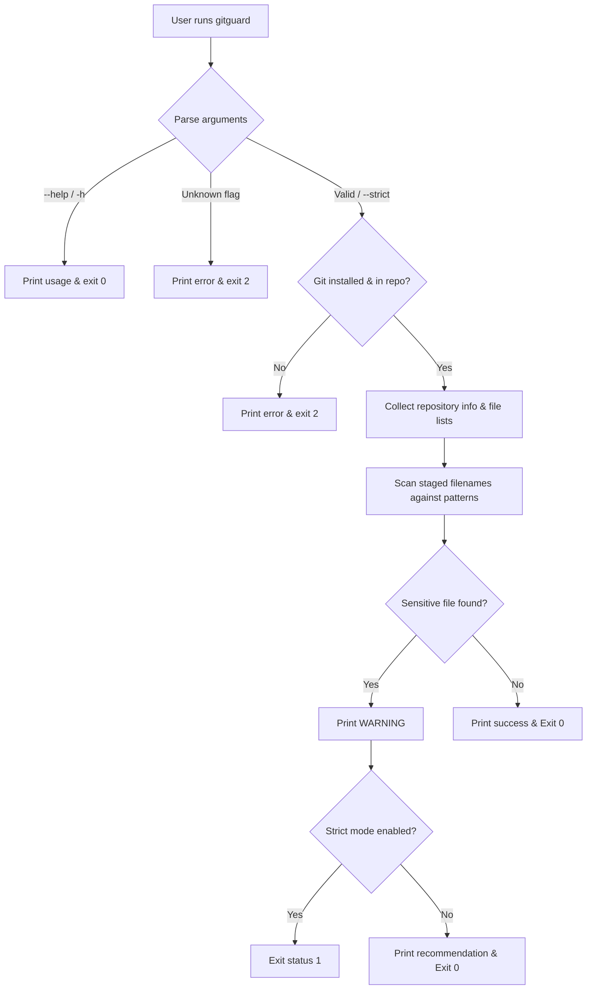

# GitGuard 🛡️

> **Custom Git Repository Safety Checker**  
> A lightweight Bash utility that reviews repository changes and flags sensitive filenames before committing.

---

## 📌 Project Overview

**GitGuard** is a pre-commit review command designed for developers and students to quickly inspect their working environment before committing code. It consolidates multiple Git status checks into a single, clean report and automatically scans staged files against filename patterns commonly associated with secrets, credentials, or environment configurations.

* **Programme:** MCA 1st Year (2026–2027)
* **Subject:** Bash Scripting / Linux, Git & Developer Workflow
* **Author / Team:** Syed Farhan Ali (Roll No. 48)
* **Date:** October 28, 2026

---

## 🚀 Key Features

- **Consolidated Overview:** Gathers staged, unstaged tracked, and untracked files into separate, color-coded terminal sections in one go.
- **Sensitive Filename Detection:** Warns if staged filenames match sensitive patterns (e.g., `.env`, `*.pem`, `*.key`, `id_rsa`, `id_ed25519`, `*credentials*`, `*secrets*`).
- **Strict Mode CLI Support:** Include `--strict` to exit with status code `1` if a sensitive-looking filename is staged (ideal for script automation).
- **Zero Heavy Dependencies:** Written completely in standard **Bash** and requires only a standard Git installation.

---

## 🛠️ Tech Stack & Architecture

| Layer | Choice | Rationale |
| :--- | :--- | :--- |
| **Language** | Bash | Native integration with terminal workflows and Git CLI; no runtime overhead. |
| **Parsing** | Bash Conditionals (`$1`, `$#`) | Simple, low-overhead argument handling for flags (`--help`, `--strict`). |
| **Dependencies**| Git CLI & standard UNIX tools | Maximum portability without requiring third-party package managers. |

### System Workflow



---

## 🔧 Installation & Setup

1. **Clone the repository:**
   ```bash
   git clone https://github.com/YOUR_USERNAME/YOUR_REPOSITORY.git
   cd YOUR_REPOSITORY
   ```

2. **Make the script executable:**
   ```bash
   chmod +x gitguard
   ```

3. *(Optional)* **Add to your PATH for global usage:**
   ```bash
   mkdir -p ~/bin
   mv gitguard ~/bin/
   # Ensure ~/bin is in your PATH environment variable
   ```

---

## 💻 Usage & Options

```bash
gitguard [--help | -h] [--strict]
```

### Options & Flags

| Flag | Long Form | Description | Default Exit Code |
| :--- | :--- | :--- | :--- |
| `-h` | `--help` | Display usage instructions and exit. | `0` |
| | `--strict` | Returns exit status `1` if sensitive staged files are found. | `0` (warns only) |

### Exit Codes

- `0`: Completed successfully (no strict-mode failures).
- `1`: Strict mode activated and sensitive staged files were found.
- `2`: System/runtime error (Git missing, not in a Git repository, or invalid options).

---

## 📋 Examples

### 1. Basic Run
```bash
./gitguard
```
*Outputs repository root, branch, staged/unstaged/untracked files, and safety recommendation.*

### 2. Strict Mode Check
```bash
./gitguard --strict
echo $?
```
*If a `.env` file is staged, prints a warning and exits with status `1`.*

---

## 🧪 Manual Testing Matrix

| Test ID | Scenario / Command | Expected Behavior |
| :---: | :--- | :--- |
| **1** | Run `./gitguard` in a clean Git repo | Displays empty sections and states nothing is staged. |
| **2** | Stage a normal file (`file.txt`) and run `./gitguard` | Listed under staged changes with no warnings. |
| **3** | Stage a dummy `.env` file and run `./gitguard` | Flags `.env` under sensitive-file check. |
| **4** | Run `./gitguard --strict` with `.env` staged | Flags warning and returns exit status `1`. |
| **5** | Run `./gitguard` outside any Git repository | Displays repository error and exits with status `2`. |
| **6** | Run `./gitguard --help` | Displays help message and exits with status `0`. |
| **7** | Run `./gitguard --nonsense` | Displays unknown option error and exits with status `2`. |

---

## 📊 Prior Art Comparison

| Tool | Focus | Comparison to GitGuard |
| :--- | :--- | :--- |
| **`git status` / `git diff`** | Standard Git inspection | Requires running multiple commands manually; no built-in pattern warning. |
| **[Gitleaks](https://github.com/gitleaks/gitleaks)** | Comprehensive secret scanner | Excellent for deep content scanning; requires additional binary & setup. |
| **[git-secrets](https://github.com/awslabs/git-secrets)** | AWS/Git hook secret prevention | Focuses primarily on commit blocking via hooks rather than quick status reports. |
| **[detect-secrets](https://github.com/Yelp/detect-secrets)** | Enterprise baseline scanner | Content-oriented scanner requiring baseline files and Python environment. |

* **GitGuard's Niche:** Provides a quick, single-command summary comparing all file states alongside filename-based pre-commit checks for standard classroom/small project workflows.

---

## ⚠️ Limitations & Security Note

- **Filename Only:** GitGuard scans filenames, **not** file contents. It will not catch hardcoded secrets or API keys inside arbitrary files.
- **False Positives/Negatives:** Pattern matching relies on standard shell globbing (`.env`, `*.pem`, `*credentials*`, etc.).
- **Manual Control:** Normal mode warns the user but does not actively prevent `git commit` unless integrated into a pre-commit hook in `--strict` mode.

---

## 📄 License

Distributed under the MIT License. See `LICENSE` for more information.
